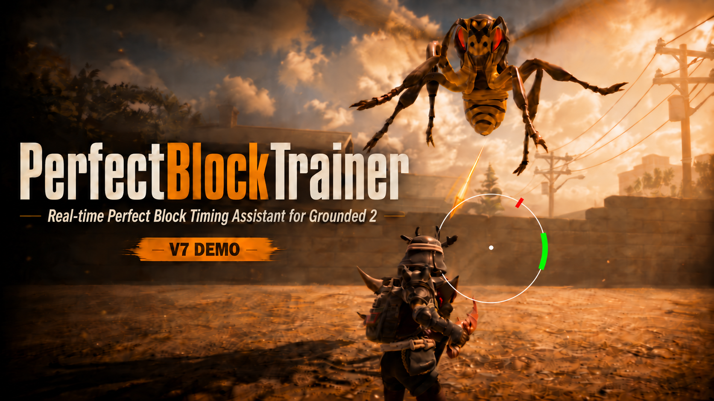
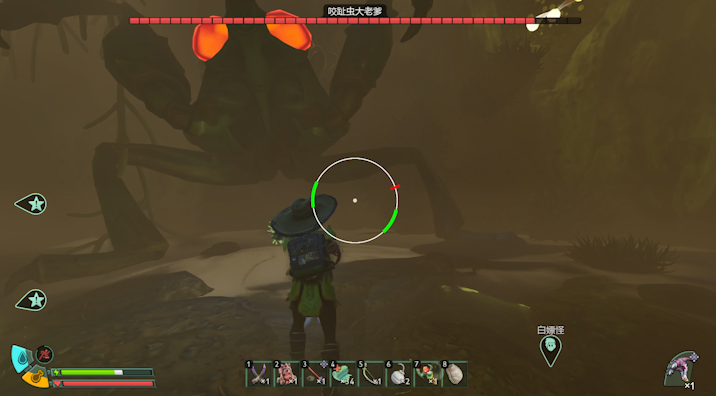
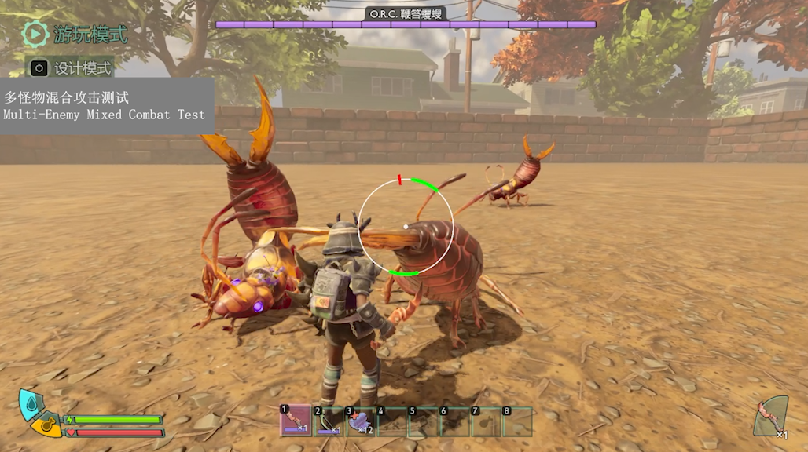
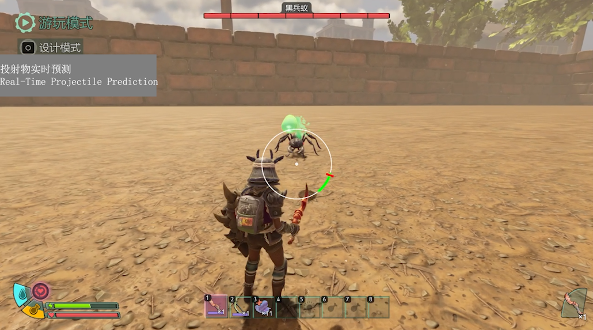
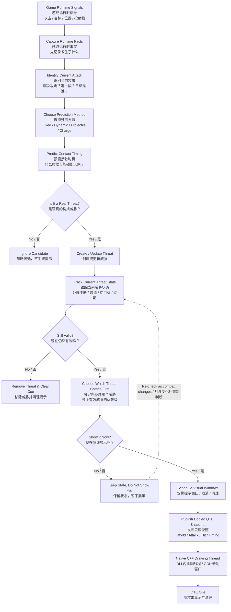

<p align="center">
  
</p>

<h1 align="center">PerfectBlockTrainer</h1>

<p align="center">
  <b>Real-time Combat Training & Threat Decision System for Grounded 2</b>
</p>

<p align="center">
  Turns hidden combat timing into observable, real-time player feedback without automating player input.<br>
  将隐藏的战斗时序转化为可观察的实时反馈，同时保留玩家自己的判断与操作。
</p>

<p align="center">
  <a href="https://github.com/Dio23366/PerfectBlockTrainer-Releases/releases"><b>GitHub Releases</b></a>
  &nbsp;•&nbsp;
  <a href="https://www.nexusmods.com/grounded2/mods/198"><b>Nexus Mods</b></a>
  &nbsp;•&nbsp;
  <a href="https://www.youtube.com/watch?v=FDF9kzwFmH4"><b>Gameplay Demo</b></a>
  &nbsp;•&nbsp;
  <a href="INSTALL.md"><b>Installation Guide</b></a>
</p>

---

## Product Overview / 产品概述

**PerfectBlockTrainer** started from a simple player problem: in complex combat, the timing behind Perfect Block opportunities is difficult to observe, understand, and practice reliably.

Instead of automating combat, the product converts hidden runtime timing into player-facing decision support:

```text
System predicts
→ UI explains
→ Player decides
→ Game validates
```

A fixed countdown is not enough once combat includes multi-hit attacks, charge / moving-body attacks, projectiles, multiple simultaneous threats, target changes, interrupts, cancellations, and different blockable / unblockable semantics. The system therefore evolved into a stateful real-time decision system that continuously decides **what an observed event means, whether it still constitutes a valid threat, and whether that threat should be shown to the player now**.

**中文说明**

PerfectBlockTrainer 从一个真实玩家问题出发：复杂战斗中的完美格挡时序原本隐藏在动画和 Runtime 中，玩家很难稳定观察、理解和练习。

它不替玩家自动格挡，而是负责预测和解释，让玩家自己判断与操作，再由游戏结果验证。随着多段攻击、冲刺、投射物、多敌人、目标切换、攻击取消等情况出现，系统真正需要解决的也不再只是“倒计时”，而是持续判断：**发生了什么、它意味着什么、是否仍然构成威胁，以及当前是否值得展示。**

### Public release & usage / 公开发布与使用情况

- **Current Public Build:** V7.0.8 — native QTE architecture (available on [Nexus Mods](https://www.nexusmods.com/grounded2/mods/198))
- **Nexus distribution snapshot:** figures below are from the screenshot supplied on October 29, 2026; they are a dated snapshot, not live counters.
- **574 Unique Downloads** on Nexus Mods
- **863 Total Downloads** on Nexus Mods
- **4,189 Nexus Views**
- **10 Endorsements**
- **10,000+ cumulative views** across public Bilibili videos (historical October 9, 2026 snapshot)
- Continuous public iteration from V7.0 through V7.0.8
- Real-user feedback covering performance, compatibility, installation, attack coverage, multiplayer behavior, and UX

> Nexus download and view counts reflect public distribution and discovery activity. They are not treated as DAU, retention, or active-user metrics.
>
> Nexus 的下载与浏览数据只作为公开发布和 Adoption 信号使用，不等同于 DAU、留存或活跃用户指标。

---


## In-Game Preview / 实机效果

The following historical screenshots show PerfectBlockTrainer running in Grounded 2. They illustrate combat scenarios from earlier releases, not the exact V7.0.8 renderer appearance.

以下历史截图保留此前版本的实战案例，不将旧 UI 画面标注为 V7.0.8 原生渲染器截图。

| Perfect Block Timing / 单次格挡时机 | Multi-Threat Handling / 多威胁处理 | Dynamic Contact Prediction / 动态接触预测 |
| :---: | :---: | :---: |
|  |  |  |
| Real-time Perfect Block timing guidance. | Multiple incoming threats and timing relationships. | Dynamic contact prediction for moving-body and projectile attacks. |

For timing, motion, and transitions, watch the [gameplay demo](https://www.youtube.com/watch?v=FDF9kzwFmH4).

*All screenshots are captured from actual PerfectBlockTrainer gameplay in Grounded 2.*

*所有截图均来自 PerfectBlockTrainer 在《禁闭求生 2》中的实际游戏画面。*


---

## Explore the Project / 深入了解项目

- **[Product Case Study / 产品案例](docs/PRODUCT_CASE_STUDY.md)** — Product goals, design decisions, player feedback, iteration, and validation. / 产品目标、设计取舍、玩家反馈、版本迭代与验收。

- **[Technical Design / 技术设计](docs/TECHNICAL_DESIGN.md)** — Runtime architecture, prediction routing, threat lifecycle, multi-threat arbitration, and engineering validation. / 运行时架构、预测路径、威胁生命周期、多威胁仲裁与工程验收。

---

## Runtime Decision Flow / 实时决策流程

This diagram intentionally shows the **production runtime path** only. Development probes, release hardening, and later validation evidence are not expanded into the main architecture, because they belong to engineering verification rather than the player-facing runtime decision chain.

> 这张图只描述 **PBT 正式运行时的核心决策路径**。开发 Probe、发布硬化和后续验证证据不会展开进主架构图，因为它们属于工程验证，而不是玩家实际看到的 Runtime 主链路。



The architecture remains deliberately compact: **observe → identify → choose a prediction path → predict contact → validate the threat → track its lifecycle → resolve priority → decide whether to display it**.

V7.0.8 preserves the established prediction, threat-admission, lifecycle, arbitration and scheduling core, while replacing its presentation dependency. The final renderer is native C++ inside the PBT DLL, not a UE Widget/LogicMods asset and not a companion executable.

**中文理解**

V7.0.7 主要在既有框架内扩展覆盖与动态预测；V7.0.8 则将预测核心与具体显示实现进一步解耦。核心负责“何时、对谁、展示哪种窗口”，快照接口传递值，绘图线程负责“怎样画出来”。迁移显示层没有重新设计攻击时序算法。

---

## V7.0.8 Architecture Migration / 架构迁移

The engine update exposed a dependency boundary: the C++ predictor and the old UE5.6 presentation assets had different compatibility risks. Replacing timing rules to work around broken UI would have coupled unrelated responsibilities.

```text
V7.0.7: C++ prediction / arbitration / scheduling
        → UE Widget + materials + LogicMods → QTE

V7.0.8: C++ prediction / arbitration / scheduling
        → versioned copied QTE snapshot → native UI thread → GDI+ transparent window
```

- **Core retained:** attack identity, per-hit timing, dynamic correction, threat admission, arbitration and cancellation remain in the established C++ core.
- **Explicit data boundary:** version/size, sequence, world generation, attack generation, hit identity, assigned windows, pointer phase and cue semantics travel as copied values. The renderer does not dereference Unreal objects or estimate another contact time.
- **Thread boundary:** publication uses a bounded snapshot and consistency stamp; the consumer discards partial copies and rejects stale or unbound state. Game time remains authoritative; the UI does not freely extrapolate combat time through pauses.
- **Native output:** a dedicated thread in the same DLL draws the white ring, hollow frames and Bézier pointer. Startup happens from a viewport callback, not `DllMain`; shutdown signals the worker, which retains its module until cleanup completes.
- **Lifecycle included:** world/local-player invalidation, attack cancellation, stale publication and finished windows affect visibility. Startup preview waits for valid data, pauses across loading gaps, and yields to real combat cues.
- **Deployment result:** one mod folder, no old LogicMods, no companion EXE, no bundled .NET. The final ZIP is **223,237 bytes (about 218 KiB)**.

A C# companion was an intermediate UI implementation used during the migration. Its self-contained package was about 66.9 MiB; most of that was runtime dependencies. The final native DLL is 512,512 bytes, slightly larger than the earlier C++ core because it now includes drawing. Package shrinkage is a dependency reduction, not an FPS benchmark.

**中文说明**

这次迁移改变的是预测结果与显示实现之间的边界：保留成熟的 C++ 核心，以有版本与代次信息的快照连接原生绘图线程，不再依赖 UE5.6 的 Widget、材质和 LogicMods。C# 独立圆环是中间验证方案，最终公开版已经移除伴随 EXE 与 .NET。

显示解耦并不等于取消生命周期管理：快照一致性、世界/攻击代次、数据过期、攻击结束以及线程退出都需要有明确处理。绘图后端消费核心已经决定的窗口，不另算一套预测。窗口仍独立于游戏的渲染画面，因此 OBS 游戏采集未必包含圆环。

---

## Key Runtime Concepts / 核心运行概念

The README uses action-oriented names first. The original technical terms are kept in parentheses where they are useful for implementation discussions.

> 为了让第一次接触项目的人直接看懂，这里优先使用“这一层具体在做什么”的名称；需要讨论实现时，再保留原来的技术术语作为括号说明。

| What this stage does / 这一层在做什么 | Meaning in PerfectBlockTrainer / 在 PBT 中的实际含义 |
|---|---|
| **Capture Runtime Facts / 获取运行时事实** *(Runtime Observation)* | Record raw facts from the running game：攻击事件、来源与目标、位置、速度、投射物状态等。这里只回答“发生了什么”，暂不解释它意味着什么。 |
| **Identify Current Attack / 识别当前攻击** *(Semantic Reconstruction)* | Turn raw callbacks into an understandable attack identity：判断这是哪一个敌人、哪一次攻击、哪一段连击、是否可格挡、当前目标是谁。 |
| **Choose Prediction Method / 选择预测方法** *(Collision Topology / Routing)* | Different physical attack types need different prediction methods：固定接触、移动本体/冲刺、直线投射物、弹道投射物分别进入合适的预测路径。 |
| **Predict Contact Timing / 预测接触时机** *(Prediction)* | Estimate when a candidate attack may contact the player：根据对应的运动/攻击模型估计可能接触时间，并允许运行时持续修正。 |
| **Is It a Real Threat? / 是否真的构成威胁** *(Threat Admission)* | Decide whether a prediction is actually relevant to the current player：即使能算出时间，也要确认攻击来源、目标关系、攻击状态和物理关系仍然成立。 |
| **Track Current Threat State / 跟踪当前威胁状态** *(Lifecycle / Authority)* | Keep only current, legitimate threat state：处理打断、击晕、击杀、取消、切目标、Miss、过期，并防止旧状态重新覆盖已经更新的威胁。 |
| **Choose Which Threat Comes First / 决定先处理哪个威胁** *(Arbitration)* | When several threats are valid at once, decide which ones deserve limited UI attention first：依据接触时间、优先级和稳定性规则选择展示顺序。 |
| **Update On-screen Cue / 更新屏幕提示** *(Scheduler / Display Control)* | Turn current threat state into assigned visual windows：决定何时显示、更新或清理，发布给独立原生绘图后端；当前版本按攻击自动显示，不再提供 F8 模式循环。 |

Current production prediction families include:

```text
FIXED_SINGLE        — fixed single-hit timing / 固定单段攻击
FIXED_MULTI         — fixed multi-hit timing / 固定多段攻击
MOVING_BODY         — charge / moving attacker / 冲刺或移动本体攻击
LINEAR_PROJECTILE   — straight-line projectile / 直线投射物
BALLISTIC_PROJECTILE— arcing projectile / 弹道投射物
```

---

## Development Scope / 开发范围

PerfectBlockTrainer is independently designed, implemented, validated, released, and maintained as an end-to-end public project.

The project scope includes:

- Player problem discovery and product boundary definition
- Runtime decision-system architecture and interaction design
- AI-assisted implementation and iterative technical validation
- Runtime event capture, attack-meaning reconstruction, state transitions, and threat-validity tracking
- Release prioritization across compatibility, performance, attack coverage, reliability, and UX
- Real-user issue reproduction, root-cause analysis, and regression validation
- Runtime validation, release hardening, clean-install acceptance, and public packaging
- Release documentation, demos, and community feedback maintenance

Rather than being maintained as a one-off prototype, the project follows a continuous product loop:

```text
Player Problem
→ System Design
→ Implementation
→ Runtime Validation
→ Public Release
→ User Feedback
→ Iteration
```

**中文说明**

这个项目不是一次性 Demo。开发范围同时覆盖产品问题定义、系统设计、AI-assisted implementation、运行时验证、公开发布、用户反馈和后续迭代。

重点不只是“功能能不能跑”，而是产品在真实发布后能否被安装、理解、稳定使用，并在出现问题后形成可重复验证的修复闭环。

---

## Design Decisions Behind the Flow / 流程背后的设计判断

The architecture was **not** designed for complexity. Each separation exists because a simpler assumption failed in real runtime scenarios.

> 复杂度不是设计目标，而是问题复杂度留下来的结果。只有当更简单的假设在真实 Runtime 中失败时，才增加新的机制。

### 1. Raw Event ≠ Attack Meaning / 捕捉到事件 ≠ 已经理解攻击含义

A runtime callback tells the system that something happened, but not necessarily what the attack means.

Therefore the system reconstructs the attack meaning using information such as:

- Source — which enemy / attack source
- Montage — which animation / attack sequence
- AttackGeneration — which specific attack instance
- HitIndex — which hit inside a multi-hit sequence
- Cue semantics — blockable / unblockable / no cue
- Target relationship — who the attack is currently aimed at

**Design consequence:** raw game events are captured first; attack meaning is reconstructed only after enough context is available.

**中文理解**

游戏告诉系统“发生了一个事件”，不代表系统已经知道“这是哪一次攻击、哪一段连击、是否可格挡、属于哪个目标关系”。

因此系统先记录“发生了什么”，再通过 **Attack Meaning Reconstruction / 攻击含义还原** 判断“这是哪次攻击、哪一段、是否可格挡、当前目标是谁”。

---

### 2. Attack Started ≠ Still Threatening the Player / 攻击已经发动 ≠ 现在仍然威胁玩家

An enemy starting an attack does not mean the attack remains a valid player threat.

The attack may later be:

- Interrupted
- Stunned
- Cancelled
- Invalidated by death
- Retargeted
- Physically missed

**Design consequence:** the system explicitly tracks whether each threat is still valid, removes invalid threats, and controls which current state is allowed to update them.

**中文理解**

例如怪物已经发动攻击，但随后被打断、击晕、击杀，或者已经切换目标，那么原来的 QTE 就不能继续残留。

这就是 **Threat Validity Tracking / 威胁有效性跟踪**（技术上对应 Threat Lifecycle）存在的原因：系统持续判断威胁从创建、更新到失效、过期和清除的状态变化。

**State Update Ownership / 状态更新权**（技术上对应 Authority）解决另一类问题：旧攻击、旧预测、新目标和新的 Runtime Event 可能同时存在，系统必须明确“哪个状态现在还能更新这个威胁”，避免已经失效的旧状态重新覆盖新状态。

---

### 3. Predictable Contact ≠ Valid Threat / 能算出接触时间 ≠ 当前真的构成有效威胁

A contact time can be mathematically predicted while the candidate is still not a legitimate threat to the player.

**Design consequence:** contact-time prediction is separated from the valid-threat check, so a mathematically plausible result does not automatically become a player-facing prompt.

**中文理解**

“数学上能算出什么时候会碰到玩家”不代表这个候选攻击就应该进入正式 Threat 系统。

例如攻击来源已经失效、目标已经切换，或者当前攻击实例/物理关系已经不再成立，系统仍可能数学上算出一个时间值。因此 **Valid Threat Check / 有效威胁判定**（技术上对应 Threat Admission）会再确认：这个预测现在是否真的与玩家有关，只有通过后才进入后续流程。

---

### 4. Valid Threat ≠ Show It Now / 确实是威胁 ≠ 现在就一定要展示

Multiple valid threats can exist at the same time while player attention and visible UI capacity are limited.

**Design consequence:** when several threats are valid at once, the system first chooses priority, then controls when each cue should be shown, updated, retained, or cleared.

**中文理解**

多个 Threat 可以同时全部“合法”，但玩家注意力和 UI 槽位是有限的。

因此 **Multiple-Threat Priority Selection / 多威胁优先级选择**（技术上对应 Arbitration）先决定多个有效威胁中谁更应该占用有限 UI；随后 **Display Update Control / 提示显示与更新控制**（技术上对应 Scheduler）把持续变化的状态转换成稳定的显示、更新、切换和清理行为，避免 UI 因瞬时变化频繁抖动或残留。

---

### 5. System Recommendation ≠ Player Action / 系统给出提示 ≠ 替玩家完成操作

The system decides what information should be shown, but it does **not** perform the block for the player.

**Design consequence:**

```text
System predicts
→ UI explains
→ Player decides
→ Game validates
```

This preserves player agency and keeps the product in the category of training / decision support rather than combat automation.

**中文理解**

PBT 的边界是“系统负责预测和解释，玩家负责决策和操作”。即使系统判断某个时间点值得提示，也不会自动执行 Block。

这保证了产品仍然是训练和 Decision Support，而不是 Combat Automation。

---

## Performance Incident: QTE-active FPS Drop / 性能问题与修复

One representative post-release incident came from real user feedback.

A user reported that while the QTE pointer was active during enemy attacks, frame rate could drop from roughly **120 FPS to around 10 FPS**, then recover after the attack ended.

The response was not to broadly rewrite the rendering or prediction system.

```text
User symptom / 用户现象
↓
Clarify trigger boundary / 明确触发边界
↓
Reproduce / 复现
↓
Collect runtime evidence / 收集运行时证据
↓
Find first responsible layer / 找到最早出错层
↓
Root cause / 根因
repeated Widget rediscovery while the QTE Pointer was active
QTE Pointer 激活期间重复查找 Widget
↓
Minimum fix / 最小修复
cache the valid Widget reference
缓存有效 Widget 引用
↓
Regression validation / 回归验证
↓
Public V7.0.2 release / 发布 V7.0.2
↓
User re-confirmed the FPS drop was gone
用户再次确认掉帧问题消失
```

This incident established a debugging and release principle used throughout later development:

> **User feedback is a symptom, not automatically a requirement. Reproduce first, locate the earliest wrong layer, apply the minimum responsible fix, then run regression.**
>
> **用户反馈首先是 Symptom，而不是自动变成 Requirement。先复现，再定位最早错误层，只修改最小责任范围，最后通过 Regression 确认修复没有破坏其他正常 Case。**

The fix was then retained as a regression case so later changes could be checked against the same failure pattern rather than relying on one-time confirmation.

---

## Product Evolution / 产品演进

PerfectBlockTrainer did not move through versions by adding features at random. Priorities changed with product maturity.

```text
V7.0.0
First public release / 首次公开发布
↓
V7.0.1
Compatibility / availability
兼容性与可用性
↓
V7.0.2
Severe performance badcase fix
严重性能 Badcase 修复
↓
V7.0.3
Coverage / semantics / projectile capability
攻击覆盖、语义与投射物能力
↓
V7.0.4
Complex-combat reliability turning point
复杂战斗可靠性转折点
↓
V7.0.5
Target switching / stale-state cleanup / mixed-combat stability
目标切换、旧状态清理与混合战斗稳定性
↓
V7.0.6
Boss & variant coverage / readability / release hardening
Boss 与变体覆盖、可读性、发布硬化
↓
V7.0.7
Roster coverage / second-layer dynamic prediction / manual visibility control
生物覆盖、二层动态预测与当时的手动显示控制
↓
V7.0.8
Engine compatibility / snapshot interface / native presentation / smaller deployment
引擎兼容、快照接口、原生显示与分发精简
```

Release priorities evolved roughly as:

```text
Availability / 可用
→ Correctness / 正确
→ Reliability / 可靠
→ Coverage / 覆盖
→ UX & Readability / 可读与易用
→ Release Quality / 发布质量
```

V7.0.8 adds a new engineering priority: preserve the established combat core while moving presentation behind a tested data boundary, restoring compatibility and simplifying distribution.

**中文说明**

版本优先级不是固定的。早期首先解决“能不能正常使用”，随后才逐渐转向正确性、复杂场景稳定性、覆盖、UX 和 Release Quality。

V7.0.7 的覆盖与动态预测积累成为迁移基线；V7.0.8 重点转向跨引擎版本兼容、显示层解耦，以及减少玩家安装依赖。

Detailed per-version feature changes and player-facing patch information are maintained through **Nexus Mods** and **GitHub Releases** rather than duplicated here.

---

## Reliability & Release Engineering / 可靠性与发布

V7.0.8 separates evidence by responsibility rather than treating a successful build as gameplay acceptance.

- **Prediction preservation:** the predecessor core was reconstructed with only the intended startup/shutdown and version-label substitutions; other core companion sources remained byte-identical.
- **ABI/build:** the pinned UE4SS SDK/runtime check was retained; the native build preserved the predecessor's 57 UE4SS imports and four public exports.
- **Offline behavior:** 15 relevant test groups cover core replay/routing, generation publication, native startup integration, configuration, geometry and lifecycle. Inactive predecessor experiments are not counted as current features.
- **Renderer comparison:** 160 synthetic snapshots and 120 startup frames were compared with the preceding C# implementation; three raster outputs matched pixel for pixel.
- **Window lifecycle:** a native test host exercised actual layered-window presentation, stale-data hiding, resizing, 20 restart cycles and nonblocking module cleanup.
- **Actual gameplay:** runtime logs recorded native startup preview and combat render/clear cycles; the user confirmed normal visible behavior.
- **Package:** extraction roundtrip, installed payload identity and a legacy-free native-host layout were checked. These checks do not substitute for a full game regression of the final clean package.

**Historical baseline:** V7.0.7's published boss, charge, F8 and clean-install acceptance remains attached to that version in the [changelog](CHANGELOG.md#v707--broader-qte-coverage-dynamic-prediction--visibility-control). It is not relabeled as a fresh UE5.7 full-roster acceptance.

**中文说明**

编译、离线回放、真实绘图窗口、玩家观察和正式安装包是不同证据层。新版已有原生显示实机反馈，但不能因此自动宣称所有怪物、多人客机、分辨率切换和长期性能全部通过。完整发布包的额外干净安装实测仍保留为独立检查点。

### Public Release Hardening / 公开版本硬化

Development probes and detailed per-frame diagnostics remain excluded from the public build. Necessary startup/state/error transitions remain available for support; absence of noisy logs is not a substitute for fixing behavior.

### Distribution integrity / 分发一致性

The native package's DLL matches the locally tested candidate. Its activation marker and default configuration are verified after ZIP extraction. The old EXE package is a separate predecessor artifact, with a different identity and dependency set.

---

## Product Boundary / 产品边界

PerfectBlockTrainer is designed for:

- Combat training / 战斗训练
- Timing visualization / 时序可视化
- Attack prediction / 攻击预测
- Threat warnings / 威胁提示
- Perfect Block practice / 完美格挡练习

PerfectBlockTrainer does **not** provide:

- Automatic blocking / 自动格挡
- Automatic dodging / 自动闪避
- Automatic player input / 自动玩家输入
- Damage modification / 伤害修改
- Inventory modification / 背包修改
- Save manipulation / 存档修改
- Network manipulation / 网络修改
- Remote-player manipulation / 远端玩家操控
- Anti-detection or bypass functionality / 反检测或绕过功能

**The player always performs the actual combat input. / 最终战斗操作始终由玩家本人完成。**

---

## Current Public Capabilities / 当前公开能力

PerfectBlockTrainer currently supports multiple production prediction and presentation paths:

- Fixed single-hit attacks / 固定单段攻击
- Fixed multi-hit attacks / 固定多段攻击
- Multiple simultaneous threats / 多威胁同时预测
- Moving-body / charge attacks / 冲刺与移动本体攻击
- Linear projectile attacks / 直线投射物
- Ballistic projectile attacks / 弹道投射物
- Blockable / unblockable attack classification / 可格挡与不可格挡攻击分类
- Multi-phase attack handling / 多阶段攻击
- Runtime prediction correction / 运行时预测修正
- **Second-layer dynamic prediction for relative movement / 基于相对运动的二层动态预测**
- Threat target update / 威胁目标变化后的更新
- Automatic cleanup when attacks stop being valid threats / 攻击不再构成威胁时自动清理提示
- Chronological handling of upcoming multi-hit threats / 多段威胁按接触顺序处理
- Save / map transition cleanup / 存档与地图切换时的状态清理
- QTE Ring / Pointer cleanup / QTE Ring 与 Pointer 清理
- **Attack-driven native QTE display and cleanup / 随攻击显示与清理的原生 QTE**
- **Versioned QTE snapshot interface / 有版本与代次的 QTE 数据快照**
- **Termite-family melee/explosion cues and Centipede combos, slam and emergence routes / 白蚁家族与蜈蚣新增攻击路线**

Established prediction routes retained from earlier releases include the following. Their earlier validation is historical evidence, not a claim that every route has been re-tested after the engine migration:

- Multi-enemy and mixed-threat combat
- Mixed melee and ranged combat
- Multi-hit and special attack sequences
- Garden Masked Fighter / Mysterious Stranger boss attacks
- O.R.C. Broodmother multi-phase combo attacks
- Lizard boss representative attack routes
- ToeBiter family validated routes, including key OGRE / Leviathan variants
- AXL representative attack routes
- TayzT / RuzT / SphereBot combo coverage
- Cockroach Queen / Berserker General Headless Spray timing
- Black Ant direct-contact projectiles
- Earwig RockThrow during mixed combat
- Representative dynamic prediction cases involving Mosquito, Blue Butterfly, Bee, Wasp, Ladybug, and rolling / charge-style enemies
- Multiple simultaneous threats
- Blockable / unblockable warning behavior

> Detailed creature- and attack-level patch information is maintained on Nexus Mods and GitHub Releases.
>
> 具体怪物、攻击路线和版本级 Patch 信息主要维护在 Nexus Mods 与 GitHub Releases；本 README 更关注产品工作方式和系统能力。

---

## Visual Semantics / 提示语义

- **White ring / 白环:** timing-cycle reference; its presence alone does not prove that an attack window is active.
- **Green hollow frame / 绿色空心框:** the core-assigned recommended Perfect Block window.
- **Red pointer / 红色指针:** current position in the timing cycle.
- **Red frame / 红框:** an attack classified as a danger/dodge warning, not simply “high damage.”
- **GOLD overlap / 金色交集:** the shared time of two blockable windows, supplied by the core. It does not merge attacks or enlarge the game's block window.
- **No cue / 无提示:** a deliberately excluded or deferred route does not become an ordinary green cue.

V7.0.8 uses automatic attack-driven visibility at normal opacity. The V7.0.7 F8 FULL/DIM/HIDDEN cycle is no longer part of the current UI. Frames are hollow with the underlying ring cut away; the red spindle pointer is constructed from Bézier geometry.

Startup preview shows green, red and gold frames immediately with the ring and clears each after the pointer has fully passed. It demonstrates loading and visual language, not validation of any enemy's attack timing.

当前显示语义由核心数据决定，绘图器不根据视觉重叠自行发明金框，也不把启动演示当作实战攻击。

---

## Demo / 演示

### Gameplay Demo / 功能演示

▶ **[Watch the PerfectBlockTrainer V7.0.8 Gameplay Demo on YouTube](https://www.youtube.com/watch?v=FDF9kzwFmH4)**

The long-term gameplay demo is maintained as the product evolves. Current showcase topics include:

- Multi-enemy mixed combat
- Real-time projectile tracking
- Dynamic projectile contact prediction
- Boss attack compatibility
- Unblockable attack warnings
- Dynamic charge attack prediction
- Multi-threat QTE readability

### Installation Video / 安装视频

▶ **[PerfectBlockTrainer Complete Installation Guide](https://www.bilibili.com/video/BV1ws4R6fEYL/)**

This is a historical installation video. Its LogicMods and mods.txt steps do not describe the native V7.0.8 package. Use the current [INSTALL.md](INSTALL.md) for installation.

---

## Requirements / 依赖

- Grounded 2 **UE5.7.4**, Windows x64.
- The tested **UE4SS_Grounded2 1.0.6** distribution.
- The native V7.0.8 PBT package.

The renderer uses Windows GDI+ and the native C++ runtime. No separate .NET installation, companion EXE, or old PBT LogicMods is required. PBT activates through its own empty `enabled.txt`; no PBT enable line needs to be added to `mods.txt`. Keep other mods and loader configuration intact.

---

## Installation / 安装

Get the current V7.0.8 native package from [Nexus Mods](https://www.nexusmods.com/grounded2/mods/198), then follow [INSTALL.md](INSTALL.md). The [GitHub Releases](https://github.com/Dio23366/PerfectBlockTrainer-Releases/releases) archive retains earlier versions; do not confuse the latest existing V7.0.7 GitHub asset with the V7.0.8 native build.

```text
PerfectBlockTrainer_V7.0.8_RELEASE/
├─ Mods/
│  └─ PerfectBlockTrainerCpp/
│     ├─ enabled.txt
│     ├─ config.default.json
│     └─ dlls/main.dll
├─ INSTALL.txt
├─ RELEASE_NOTES.md
├─ VERSION.txt
└─ 第三方许可_THIRD_PARTY_NOTICES.txt
```

Upgrading requires removing the three old PBT LogicMods files. Users of the intermediate EXE build also remove `PBTQteAutoStart` after backing up/migrating personal configuration. Exact steps are in the installation guide; other mods are preserved.

---

## Known Limitations / 当前限制

V7.0.8 retains established prediction routes and adds autumn-update attacks; this does not establish exhaustive coverage of the new game version.

Current limitations include:

- `NO_CUE` attacks intentionally do not produce a normal Perfect Block prompt
- Attacks that are not treated as ordinary blockable attacks may use warning behavior or no QTE
- Explicitly deferred special attacks may still require dedicated runtime validation
- Different attacks from the same enemy can use different prediction paths and semantics
- Multiplayer validation remains primarily **host-side**; full guest/client QTE support is not yet implemented
- Centipede roaming/sprint head-contact cues are deferred; ordinary combo, slam and emergence support does not imply roaming prediction
- Swarm/harvest performance spikes, frame-generation-related resolution crashes and the broad multiplayer/window-mode matrix remain separate open investigations
- A native transparent window can still be omitted by OBS Game Capture; Display Capture can include it
- Future Grounded 2 updates may change runtime behavior or hooks and may require compatibility fixes
- PerfectBlockTrainer is a training / visualization product and does not change the game's actual Perfect Block rules

**中文说明**

V7.0.8 保留已有预测路线并增加秋季更新攻击，但不能据此宣称新版游戏的每一种招式都已重新验证。

`NO_CUE`、非普通格挡攻击、明确延期处理的特殊攻击，以及尚未完成的多人客机 QTE，都属于当前明确的产品边界。

If an attack produces no QTE where one is expected, incorrect timing, or the wrong semantic warning, please report the specific enemy and attack.

---

## Community Testing / 社区测试

Community feedback is an important part of expanding attack coverage and validating regressions.

When reporting a problem, please include as much of the following as possible:

```text
Enemy / Creature
Attack / Move name if known
Single / Combo / Charge / Projectile
Blockable / Unblockable if known
Expected behavior
Actual behavior
Missing / Early / Late / Incorrect QTE
Game version
PerfectBlockTrainer version
UE4SS version
Video / GIF if possible
```

If an issue can be reproduced consistently but cannot be reproduced during development, `UE4SS.log` may also be useful.

Recommended issue categories:

```text
BUG
ATTACK MISSING
TIMING WRONG
FALSE QTE
UNBLOCKABLE WARNING
PROJECTILE
UI
PERFORMANCE
COMPATIBILITY
```

Different attacks from the same creature are useful to report separately.

---

## Release Integrity / 发布校验

Use the official [Nexus Mods page](https://www.nexusmods.com/grounded2/mods/198) for the current native build and [GitHub Releases](https://github.com/Dio23366/PerfectBlockTrainer-Releases/releases) for the release archive.

The V7.0.8 native ZIP contains one mod directory and no nested EXE/runtime payload. Version labels alone do not identify the intermediate C# package and the final native package; their contents differ substantially.

The existing [SHA256SUMS.txt](SHA256SUMS.txt) explicitly identifies the historical V7.0.7 build. V7.0.8 does not add a player-facing checksum manifest to its package. Historical release identities are preserved rather than presented as current ones.

---

## Repository Scope / 仓库说明

This repository is the public technical and distribution home of PerfectBlockTrainer.

The public surfaces are intentionally separated by purpose:

- **GitHub README** — product concept, system architecture, development evolution, validation, and release process
- **Nexus Mods** — player-facing release information, current downloads, version-specific changes, compatibility, and community distribution
- **GitHub Releases / INSTALL.md** — release packages and installation guidance

**中文说明**

不同页面承担不同职责：GitHub README 主要说明产品本身如何工作、为什么这样设计以及如何演进；Nexus 更适合维护玩家真正关心的版本更新、兼容性、下载和具体 Patch；GitHub Releases 与 INSTALL.md 则负责正式安装包和安装说明。

这样可以避免 README 变成重复的 Patch Notes，同时让产品结构保持相对稳定。

Public repository content includes:

- Product and architecture documentation
- Release documentation
- Installation documentation
- Media / demos
- Public release hashes
- Official binary release packages

Development source code, internal runtime evidence, development probes, build artifacts, backups, and Formal Freeze archives are maintained separately and are **not distributed through this repository**.

---

## Public Links / 公开页面

- **Nexus Mods:** [PerfectBlockTrainer](https://www.nexusmods.com/grounded2/mods/198)
- **GitHub Public Repository:** [PerfectBlockTrainer-Releases](https://github.com/Dio23366/PerfectBlockTrainer-Releases)
- **GitHub Releases:** [PerfectBlockTrainer Releases](https://github.com/Dio23366/PerfectBlockTrainer-Releases/releases)
- **Gameplay Demo:** [V7.0.8 on YouTube](https://www.youtube.com/watch?v=FDF9kzwFmH4)
- **Installation Video:** [BV1ws4R6fEYL](https://www.bilibili.com/video/BV1ws4R6fEYL/)
- **Bilibili Creator Page:** [bili_55415870362](https://space.bilibili.com/3546748811217856)

---

## Credits

Built for **Grounded 2** using **UE4SS**.

Thanks to the UE4SS / RE-UE4SS project and community for the modding framework.

Grounded 2 is developed by **Obsidian Entertainment** and published by **Xbox Game Studios**.

---

## Version / 当前版本

**V7.0.8 — Native QTE Architecture / 原生 QTE 架构**

Current public runtime:

**Grounded 2 UE5.7.4 · UE4SS_Grounded2 1.0.6**

Previous public releases:

```text
V7.0.7 — Broader Coverage, Second-layer Dynamic Prediction & Manual Visibility
V7.0.6 — Expanded Combat Coverage & Boss Timing Improvements
V7.0.5 — Combat Targeting & QTE Stability Improvements
V7.0.4 — Combat Reliability & Mixed-Threat Improvements
V7.0.3 — Semantic Prediction & Coverage Expansion
V7.0.2 — Performance Fix
V7.0.1 — UE4SS_Grounded2 1.0.4 Compatibility Update
V7.0   — First Public Release
```
