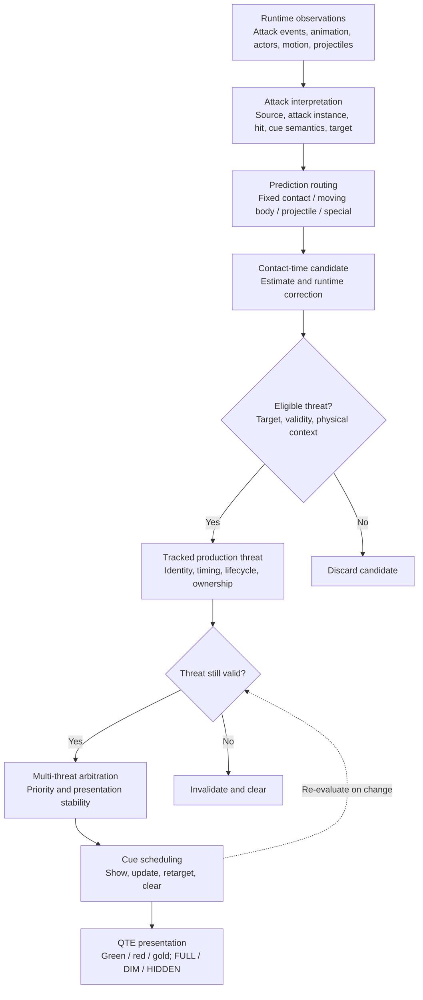
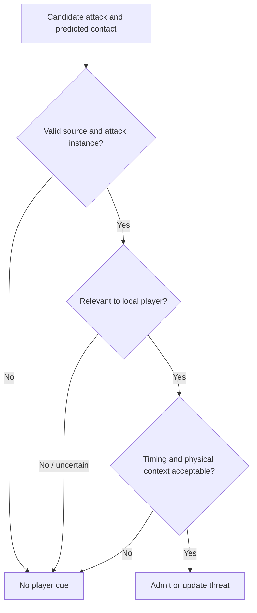
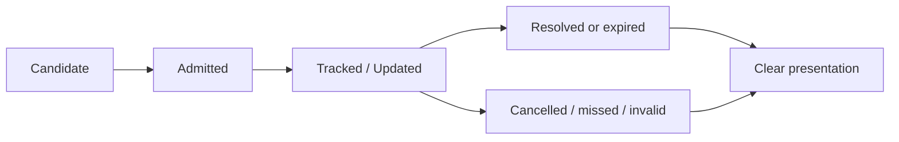
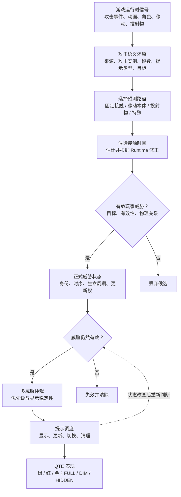
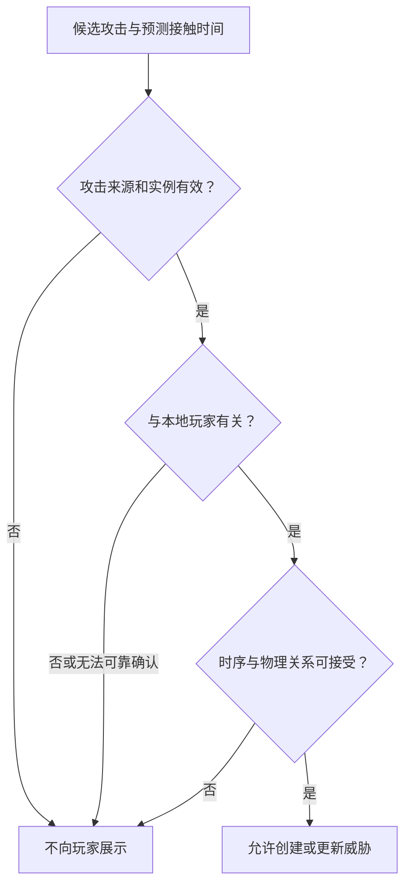
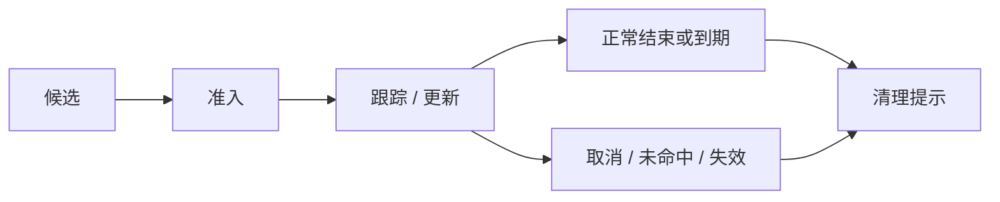

# PerfectBlockTrainer — Technical Design / 技术设计

> **Public architecture and engineering case study — V7.0.7**  
> **正式公开版架构与工程设计案例 — V7.0.7**
>
> Platform: **Grounded 2** · Runtime framework: **UE4SS_Grounded2 1.0.4**  
> Focus: runtime interpretation, predictive combat cues, threat lifecycle, multi-threat arbitration, validation

**Languages / 语言：** [English](#english) · [简体中文](#chinese)

**Project:** [README](../README.md) · [Changelog](../CHANGELOG.md) · [Gameplay demo](https://youtu.be/ae4_FEjTbQI) · [Public releases](https://github.com/Dio23366/PerfectBlockTrainer-Releases/releases)

**Documentation scope.** This document explains the design and behavior of the publicly released PerfectBlockTrainer V7.0.7. It is a technical *design explanation*, not a publication of the private development source tree. Diagrams describe architectural responsibilities rather than literal C++ classes, function calls, or executable state-enum definitions. Release-level validation statements are based on the project's published README and CHANGELOG; internal logs and full implementation source are not reproduced here.

**文档范围。** 本文解释 PerfectBlockTrainer V7.0.7 公开版本的技术设计与已发布行为，而不是公开完整私人开发源码。图示用于说明真实存在的职责与数据流，不等同于逐行 C++ 调用关系、类定义或状态枚举。文中的公开验收结论以项目 README 与 CHANGELOG 为依据；本文不提供完整内部运行日志或源码。

---

<a id="english"></a>

# English

## 1. Engineering problem and system boundary

Perfect Block opportunities in Grounded 2 arise from combat timing that is not presented as an explicit countdown to the player. A useful assistant must interpret changing runtime information while avoiding incorrect prompts when attacks cancel, miss, change targets, or overlap.

PerfectBlockTrainer is a **combat-training and decision-support system**, not an automatic combat controller:

```text
Game runtime supplies observations
→ PBT interprets and predicts
→ QTE interface explains the timing
→ Player chooses and performs the input
→ Grounded 2 applies its original combat rules
```

The implementation spans two complementary responsibilities:

| Responsibility | Engineering role |
|---|---|
| UE4SS and C++ runtime | Observe attack-related runtime information, reconstruct attack identity, select prediction paths, maintain threats, and schedule cues. |
| Blueprint / LogicMods presentation | Render timing rings, pointers, semantic warning colors, overlap indications, and visibility states. |
| Grounded 2 | Remains the authority for actual blocking, dodging, hit results, and Perfect Block validity. |

**Design invariant:** a visible prompt never means the mod has pressed Block for the player. PBT does not change the underlying Perfect Block window or damage rules.

## 2. Runtime pipeline: from observation to a visible cue



Four concepts must stay distinct:

> **Predicted contact time ≠ Eligible threat ≠ Selected presentation threat ≠ Visible QTE.**

Each separation addresses a different failure mode. A mathematically plausible contact may target another actor; a valid threat may not be the next one to show; and a selected cue may be intentionally invisible in HIDDEN mode.

## 3. Attack identity and semantic reconstruction

A runtime callback alone cannot reliably answer *which exact attack is active*. Timing predictions become meaningful only when the system has enough context to distinguish:

- **Source:** the attacking enemy or projectile origin.
- **Attack identity:** the relevant attack / animation route.
- **Attack instance:** the current generation of that attack rather than a stale earlier event.
- **Hit identity:** which hit in a multi-hit sequence is being predicted.
- **Cue semantics:** ordinary blockable cue, unblockable warning, or intentionally no cue.
- **Target relationship:** whether the attack is relevant to the local player.

**Why instance identity matters:** a repeated combo animation should not allow the timing or cancellation state of the previous attack to overwrite a later attack. Similarly, identifying a montage does not, by itself, prove that every hit should produce a green cue.

## 4. Prediction routing: one timing formula is not enough

PBT chooses prediction behavior based on the attack's physical and semantic characteristics. Publicly described production families include:

| Attack family | Prediction question | Representative challenge |
|---|---|---|
| Fixed single contact | When is the known contact in this attack instance? | Animation timing and correct attack admission. |
| Fixed multi-hit | When are the successive contacts? | Per-hit identity and correct follow-up scheduling. |
| Moving body / charge | When will the moving attacker contact the player? | Relative motion, approach/retreat, and continuously changing distance. |
| Linear projectile | When can the projectile intersect the player? | Projectile movement and invalidation on a miss. |
| Ballistic projectile | When can an arcing projectile reach the player? | Trajectory changes and meaningful contact estimation. |
| Special / non-standard cases | Should this event warn, remain silent, or use dedicated logic? | Avoiding false ordinary Perfect Block cues. |

**V7.0.7 progression:** second-layer dynamic prediction and relative-motion correction were expanded for representative moving-body and projectile attacks. Long-range world-boss FixedContact admission was also improved so boss-special situations are not incorrectly constrained by ordinary-creature proximity assumptions.

The goal is not to force all creatures through one model. It is to reuse prediction approaches for attacks with similar behavior while retaining attack-specific semantic and timing data.

## 5. Case A — Threat admission and targeting authority

**Problem.** An enemy begins a recognizable attack, and a contact time can be calculated. Nevertheless, the attack may not be intended for the local player, or the attack context may already have become invalid. Showing a QTE solely because prediction succeeded creates false positives.

**Design.** Keep prediction separate from the decision to admit a threat:



These nodes explain the **decision criteria**, not the exact executable condition order.

**Trade-off.** Conservative admission can suppress a cue when target evidence is unreliable, but showing a confidently wrong cue is worse: it teaches the player to react to an attack aimed elsewhere.

**Observed product boundary.** Reliable local target information is a particular challenge for multiplayer clients. Single-player and host-side support are the supported paths; full guest/client QTE behavior is **not implemented reliably** in V7.0.7. Rendering a ring on the client is not evidence that client-side target authority works.

## 6. Case B — Threat lifecycle and stale-state prevention

**Problem.** A cue may be valid when first predicted but later become wrong because an enemy dies, an attack cancels, the player escapes the contact path, the source retargets, or an older update arrives after a newer one.

**Design.** Track threats as changing entities rather than fire-and-forget countdowns:



*The labels above are conceptual lifecycle stages, not published C++ enum values.*

This architecture needs two related properties:

1. **Validity tracking:** a cue is removed when its attack is no longer a legitimate threat.
2. **Update ownership:** a stale generation or no-longer-authoritative state must not revive a cleared cue or overwrite a newer attack.

**Public validation trail.** V7.0.5 specifically addressed ghost or stuck QTEs, attack-end cleanup, mixed Wasp/Mosquito cases, and old prompts reappearing after their attacks had ended. Those cases are not merely UI styling issues; they reflect lifecycle and ownership correctness.

## 7. Case C — Multi-threat arbitration and the scheduler

**Problem.** Multiple valid attacks can overlap. The system must preserve information about those threats without constantly switching the visible cue whenever contact predictions shift slightly.

**Design.** Separate threat tracking from the selection and timing of what the player sees:

- **Threat store:** maintain valid, distinct attacks and hit instances.
- **Arbitration:** resolve which threats deserve immediate presentation attention using upcoming contact, relevance, and stability rules.
- **Scheduler:** convert the selected threat state into show, update, retarget, and clear operations.
- **Presentation:** render one or more rings as appropriate to the current UI state.

This avoids assuming that a new candidate should instantly displace the current QTE. Presentation stability is itself a correctness goal: an unstable cue can be hard to act on even when each intermediate prediction is mathematically reasonable.


*Actual gameplay image. The screenshot illustrates player-facing multi-threat presentation, not a frame-accurate arbitration benchmark.*

**GOLD overlap** is the shared portion of two independent blockable green windows. It is a visual readability aid, not an expanded Perfect Block window and not a change to game rules.

## 8. Presentation is a separate layer

Visual semantics describe the *kind* of recommendation, not the internal prediction mechanism:

| Visual element | Meaning |
|---|---|
| White ring | Timing-cycle visualization. |
| Green window | Recommended Perfect Block timing window. |
| Red pointer | Current timing position. |
| Red warning | Unblockable attack / dodge warning. |
| GOLD overlap | Shared overlap of two independent blockable timing windows. |
| No cue | A route intentionally excluded from ordinary QTE presentation. |

In V7.0.7, **F8** cycles `FULL → DIM → HIDDEN → FULL`. This changes visual presentation only: attack observation, prediction, and threat tracking continue in DIM and HIDDEN modes. That separation prevents a UI preference from silently changing combat-state behavior.

## 9. Case D — Dynamic prediction and visual continuity

**Problem.** A simple animation-relative countdown cannot remain accurate when both attacker and player are moving. A charge may start far away; the player may approach or retreat; a projectile may miss or change expected contact timing.

**Design response.** Keep attack identification separate from motion-based contact estimation, and allow predictions to update as runtime state changes. The visual output should respond to meaningful timing updates without becoming a flickering or discontinuous instruction.


*Actual gameplay image showing a dynamic-prediction scenario; temporal accuracy is evaluated through gameplay observation and runtime evidence rather than inferred from a single image.*

**V7.0.7 evidence.** Public release notes report validated representative charge and moving-body scenarios, relative-motion and projectile improvements, and boss multi-hit coverage. They do **not** establish that every future animation, trajectory, or game update is automatically supported.

## 10. Verification: build success is not gameplay acceptance

PBT uses distinct evidence layers. Success at one layer cannot substitute for success at another:

| Layer | Question it answers | Example of a failure it can detect |
|---|---|---|
| Build / deployment | Did the target binary build and deploy as intended? | Build failure, missing or mismatched DLL. |
| Runtime behavior | Did identity, target, prediction, threat state, and scheduler behave as intended? | Wrong target, invalid admission, stale threat. |
| In-game visual behavior | Did the player actually see a readable cue at the intended stage? | White ring without the expected green window, flicker, visible discontinuity. |
| Public package acceptance | Does the distributed package work in a clean player-style installation? | Missing LogicMods files or release-only configuration regression. |

For a change such as *“show a stable QTE during a moving attack's wind-up”*, the intended acceptance is therefore not merely “DLL compiled” or “predictor emitted a timestamp.” It also requires the visible QTE to appear during the intended phase, remain coherent, and clear when the threat ends.

A particularly useful diagnostic distinction is:

```text
Runtime says eligible + scheduled  /  UI shows no expected cue
→ Investigate presentation / bridging / initialization.

Runtime never admitted an eligible threat  /  UI shows no cue
→ Investigate attack identity, target evidence, or threat admission first.
```

These are **diagnostic hypotheses**, not proofs of a single root cause from appearance alone. A white ring proves some presentation assets loaded; it does not independently prove that the C++ threat pipeline is fully active.

### Representative public V7.0.7 acceptance

Published V7.0.7 validation includes the Mysterious Stranger, O.R.C. Broodmother's Slow 5-Combo / Fast 5-Combo / Fast 3-Combo, representative charge behavior, the F8 visibility cycle, public-runtime smoke testing, and clean-install package testing. The full test scripts, raw logs, and private source tree are not part of this public repository.

## 11. Engineering constraints and non-goals

- **No input automation:** PBT never presses Block or Dodge for the player.
- **No replacement of game authority:** Grounded 2 still judges the actual Perfect Block.
- **No guarantee of a cue for every animation:** `NO_CUE`, unblockable, and deferred special cases have distinct semantics.
- **No claim of reliable guest/client support:** client-side attack targeting remains an unresolved limitation.
- **No claim that attack data is already externalized:** the current public architecture describes data-driven *routing concepts*, but moving attack-specific records out of compiled C++ is a possible future refactor, not a completed V7.0.7 feature.
- **No public-source claim:** diagrams and examples in this document are explanations, not excerpts of the undistributed production source.

## 12. Engineering takeaway

The central engineering move was to stop treating the problem as “one countdown per creature.” Instead, PBT separates observation, interpretation, prediction, threat validity, lifecycle, arbitration, scheduling, and presentation so that changes can be verified at the layer that owns them.

> **A useful combat cue must be predicted, relevant, current, prioritized, and readable — not merely calculable.**

---

<a id="chinese"></a>

# 简体中文

## 1. 工程问题与系统边界

《禁闭求生 2》的完美格挡时机存在于实际战斗过程中，但游戏并不会把完整攻击时序直接变成玩家可读取的倒计时。一个可靠的提示 Mod，既要解释不断变化的运行时信息，也要避免攻击取消、未命中、切换目标、多攻击重叠时产生错误提示。

PerfectBlockTrainer 的定位是**战斗训练与实时决策辅助系统**，不是自动战斗控制器：

```text
游戏 Runtime 提供观察信息
→ PBT 识别、解释并预测
→ QTE 界面说明格挡时机
→ 玩家自行判断和按键
→ 游戏按原有战斗规则判定
```

技术实现由不同职责组成：

| 职责 | 在系统中的作用 |
|---|---|
| UE4SS 与 C++ Runtime | 获取攻击相关运行时信息、还原攻击身份、选择预测路径、维护威胁状态与安排提示时机。 |
| Blueprint / LogicMods 表现层 | 绘制圆环、指针、不同语义的警告颜色、金色重叠区以及显示模式。 |
| Grounded 2 游戏本体 | 仍然决定格挡、闪避、命中和真正的完美格挡是否成立。 |

**关键边界：** QTE 出现在屏幕上，不意味着 Mod 已经代替玩家按下格挡键。PBT 不修改游戏的格挡窗口或伤害规则。

## 2. 核心运行链路：从观察到可见 QTE



系统中有四件不能混为一谈的事：

> **预测到接触时间 ≠ 构成有效威胁 ≠ 成为当前展示对象 ≠ 屏幕上实际可见 QTE。**

每一次职责分离都对应一类真实问题。数学上可以计算接触时机，但攻击可能打向其他目标；一个合法威胁未必是最该展示的威胁；而 HIDDEN 模式下，即使内部正常预测和调度，玩家也会主动选择不看见 QTE。

## 3. 攻击身份与语义还原

仅凭某个 Runtime 回调，无法可靠确定**当前是哪一次具体攻击**。要让时间预测有意义，系统需要结合更多上下文：

- **Source / 来源：** 谁发动攻击，或投射物来自哪里。
- **Attack Identity / 攻击身份：** 当前的攻击、动画或招式路线。
- **Attack Instance / 攻击实例：** 这是本次攻击，而不是之前残留的同名事件。
- **Hit Identity / 段数身份：** 多段连击中当前预测的是哪一段。
- **Cue Semantics / 提示语义：** 普通可格挡、不可格挡警告，还是有意不提示。
- **Target Relationship / 目标关系：** 当前攻击是否与本地玩家相关。

**为什么要区分攻击实例？** 因为同一个连击动画可能连续触发多次。前一次攻击的旧计时或旧取消状态，不应该覆盖新一轮攻击。类似地，仅识别到动画，并不能证明这个动画的每一段都应该出现绿色 QTE。

## 4. 预测路径：不能用一个时间公式处理全部攻击

PBT 根据攻击的物理特征和语义选择不同的预测方式。目前公开说明中的主要能力包括：

| 攻击类型 | 系统需要预测什么 | 代表性难点 |
|---|---|---|
| 固定单段接触 | 已确认的攻击实例何时接触玩家 | 动画时序与攻击准入判断。 |
| 固定多段接触 | 每段连击分别何时接触 | 段数身份、后续段的调度。 |
| 移动本体 / 冲刺 | 移动中的攻击者何时碰到玩家 | 相对速度、靠近或远离、持续变化的距离。 |
| 直线投射物 | 投射物何时与玩家路径相交 | 投射物运动、未命中后的撤销。 |
| 弹道投射物 | 弧线投射物何时可能到达玩家 | 弹道变化与接触估计。 |
| 特殊 / 非标准路线 | 应警告、不提示，还是使用专用逻辑 | 防止误显示普通完美格挡 QTE。 |

**V7.0.7 的增强：** 对部分移动本体、冲刺和投射物攻击强化二层动态预测与相对运动修正；世界 Boss 的远距离 FixedContact 场景也进行了专门准入改进，避免直接套用普通生物的距离条件导致提示过晚。

目标不是把所有虫子的攻击都塞进同一个公式，而是让相似攻击复用对应预测框架，同时保留具体攻击的语义与时间数据。

## 5. 技术案例 A：Threat Admission 与攻击目标判定

**问题。** 怪物开始攻击，系统也算出了接触时间，但这招未必在攻击本地玩家，甚至可能已经取消。如果“预测成功”就直接显示 QTE，会让玩家看到针对其他目标的错误提示。

**设计。** 把“预测接触”与“允许进入正式 Threat 系统”拆开：



这里列出的是**概念上的判断条件**，不表示源码必须严格按照图中的逐项顺序执行。

**取舍。** 保守的准入机制在目标证据不足时可能放弃一次提示，但随意显示一个明确错误的 QTE，反而会误导玩家去格挡根本没有攻击自己的招式。

**当前限制。** 多人客机难点恰恰在于攻击目标信息不够可靠。V7.0.7 以单人和房主侧为已支持路径，Guest / Client 端 QTE **尚未达到可靠完整支持**。客机上能出现白色圆环，不等于已经解决了客户端目标判定。

## 6. 技术案例 B：Threat Lifecycle 与过期状态清理

**问题。** 预测创建时可能正确，但怪物死亡、攻击中断、玩家离开碰撞路径、目标切换，或旧事件晚于新状态到来时，原来的提示就可能变成错误状态。

**设计。** 让 Threat 成为可持续更新、可失效、可清理的状态对象，而不是一次性启动的倒计时：



*以上是用于说明职责的生命周期示意，不是公开的 C++ 状态枚举定义。*

需要同时保证两点：

1. **有效性跟踪：** 攻击不再构成真实威胁时，QTE 必须失效并清理。
2. **状态更新权：** 旧攻击实例和不再有效的更新，不能让已经清理的 QTE 复活，也不能覆盖新攻击。

**公开版本中的证据。** V7.0.5 明确修复过旧 QTE 重新出现、攻击结束后提示残留、混合黄蜂与蚊子战斗中的目标问题，以及少数长期卡住的 QTE。这些问题不只是视觉瑕疵，更反映 Threat Lifecycle 与状态更新权是否正确。

## 7. 技术案例 C：多威胁仲裁与 Scheduler

**问题。** 多个合法攻击可以在相近时间发生。系统不仅要保留多个威胁的信息，还要避免接触时间稍微波动时，屏幕提示就频繁切换。

**设计。** 把“保留哪些有效 Threat”与“当前向玩家展示什么”分成不同职责：

- **Threat Store / 威胁状态：** 保留当前有效、能够区分攻击实例和段数的威胁。
- **Arbitration / 仲裁：** 综合预计接触顺序、相关性与稳定性，决定当前最值得占用显示资源的威胁。
- **Scheduler / 调度：** 将仲裁结果转化为显示、更新、重新指向和清除动作。
- **Presentation / 表现：** 根据有效威胁与当前 UI 状态展示一个或多个 QTE 圆环。

这避免了“新候选一出现就抢占当前 QTE”的简单行为。**稳定可读本身也是正确性的一部分**：即使算法在每个瞬间都能计算出合理时间，频繁跳变的视觉提示对玩家仍可能不可用。


*真实游戏截图，用于展示玩家看到的多威胁画面，不等于逐帧仲裁性能测试。*

**GOLD / 金色重叠区**表示两个独立、可格挡的绿色时机窗口发生公共重叠。这只改善可读性，不延长游戏原生 Perfect Block 窗口，也不改变游戏判定。

## 8. 显示层必须与内部预测分离

不同颜色表示的是提示**语义**，而不是内部算法走了哪一种路径：

| 视觉元素 | 玩家能理解的含义 |
|---|---|
| 白色圆环 | 时机周期可视化。 |
| 绿色区域 | 推荐的 Perfect Block 时机。 |
| 红色指针 | 当前计时位置。 |
| 红色警告 | 不可格挡攻击 / 闪避警告。 |
| 金色重叠区 | 两个独立可格挡窗口的公共重叠时间。 |
| 不显示 | 当前攻击被定义为不应产生普通 QTE 的路线。 |

V7.0.7 加入 **F8** 显示模式切换：`FULL → DIM → HIDDEN → FULL`。它只影响可见表现。即使玩家选择 DIM 或 HIDDEN，攻击观察、预测和威胁状态跟踪依旧运行。这样用户的界面偏好就不会意外改变底层战斗时序处理。

## 9. 技术案例 D：动态接触预测与视觉连续性

**问题。** 当怪物和玩家都在运动时，只靠“动画开始后倒计时”无法长期保持正确。冲刺可能从远处开始，玩家可能靠近或后退，投射物也可能错过玩家或改变预计接触时间。

**设计方向。** 攻击身份由语义层识别，接触时机则结合运动状态持续估计；新的运行时信息可以修正预测。同时，视觉表现应对有意义的时序变化做出反应，而不是出现明显闪烁、突然后跳或毫无原因的重建。


*真实游戏中的动态预测场景。单张截图能证明界面出现，但不能单独证明连续运动中的毫秒级准确性；这种验收需要结合实际战斗观察与 Runtime 证据。*

**V7.0.7 的公开证据。** Release Notes 记录了代表性的冲刺、移动本体、相对运动、投射物以及 Boss 多段连击的改进与测试。它不意味着所有未来攻击动画、弹道或游戏版本都已经自动获得支持。

## 10. 验收方法：编译成功不等于游戏效果通过

PBT 的验收应区分不同的证据层。上一层成功，不能直接替代下一层：

| 验收层 | 实际验证的问题 | 能发现的典型失败 |
|---|---|---|
| 构建与部署 | DLL 是否按目标成功构建和部署 | 编译失败、DLL 缺失或身份不一致。 |
| 运行时行为 | 攻击身份、目标、预测、Threat、Scheduler 是否按预期工作 | 错误目标、未准入、过期威胁复活。 |
| 游戏内视觉体验 | 玩家是否在正确阶段实际看到清晰、稳定的 QTE | 只见白环没有预期绿框、闪烁、视觉跳变。 |
| 正式安装包验收 | 对玩家发布的 ZIP 能否全新安装后工作 | LogicMods 文件缺失、公开构建配置差异。 |

例如“让某个移动攻击在起手阶段稳定出现 QTE”，验收条件就不能只是“DLL 编译成功”或“预测器产生一个时间戳”；还必须确认提示在应有阶段出现、变化连续，并在威胁结束后正确清理。

一个有帮助的故障分层方式是：

```text
Runtime 表示威胁已准入并调度  /  实际画面没有预期 QTE
→ 优先检查表现层、数据连接或初始化。

Runtime 根本没有准入有效威胁  /  画面没有 QTE
→ 优先检查攻击身份、目标证据或 Threat Admission。
```

这些只是**定位方向**，不能仅凭画面就断言某个唯一根因。能显示白色圆环，说明部分 UI 资源已经加载，但不能独立证明 C++ 的完整威胁处理链已正常工作。

### V7.0.7 的代表性正式验收

公开 CHANGELOG 记录的 V7.0.7 验收包括：神秘人攻击、O.R.C. 育母蜘蛛的 Slow 5-Combo / Fast 5-Combo / Fast 3-Combo、代表性冲刺攻击、F8 显示循环、公开 Runtime 冒烟测试，以及玩家式全新安装包测试。完整测试脚本、原始运行日志和私人开发源码不属于这个公开仓库的交付内容。

## 11. 工程边界与当前没有实现的事项

- **不自动输入：** PBT 不代替玩家按下格挡或闪避。
- **不替代游戏规则：** 真正的 Perfect Block 仍由 Grounded 2 判定。
- **不要求每个动画都有 QTE：** `NO_CUE`、不可格挡和明确延期处理的特殊攻击具有不同语义。
- **不宣称客机已经完整支持：** 多人 Client / Guest 的可靠攻击目标判定仍是当前限制。
- **不宣称攻击数据已经外置：** 目前已有按语义和攻击类型进行路由的设计，但把全部攻击记录从编译后的 C++ 中拆成独立数据文件，仍是未来可能的重构方向，并非 V7.0.7 已完成能力。
- **不将图示当作公开源码：** 本文流程图与文字用于解释系统职责，不是未公开生产源码的逐行引用。

## 12. 工程总结

PBT 最重要的工程变化，是不再把问题简单理解为“给每种虫子做一条倒计时”。它将观察、语义还原、预测、威胁准入、生命周期、仲裁、调度和 UI 显示拆成可分别验证的层次，让出现问题时能够找到对应的责任范围。

> **一个真正有价值的战斗提示，不仅要算得出，还必须与玩家有关、仍然有效、优先级正确，并且足够稳定易读。**

---

## References / 参考资料

- [Project README — public architecture and product behavior](https://github.com/Dio23366/PerfectBlockTrainer-Releases/blob/main/README.md)
- [Project CHANGELOG — published version changes and acceptance results](https://github.com/Dio23366/PerfectBlockTrainer-Releases/blob/main/CHANGELOG.md)
- [V7.0.7 public releases](https://github.com/Dio23366/PerfectBlockTrainer-Releases/releases)
- [Gameplay demo — actual in-game behavior](https://youtu.be/ae4_FEjTbQI)
- [Nexus Mods — release distribution and player-facing notes](https://www.nexusmods.com/grounded2/mods/198)

**Repository placement / 上传路径：** `docs/TECHNICAL_DESIGN.md`  
**Document type / 文档定位：** public technical design case study; not a source-code release / 公开技术设计案例，不是完整源码发布。
